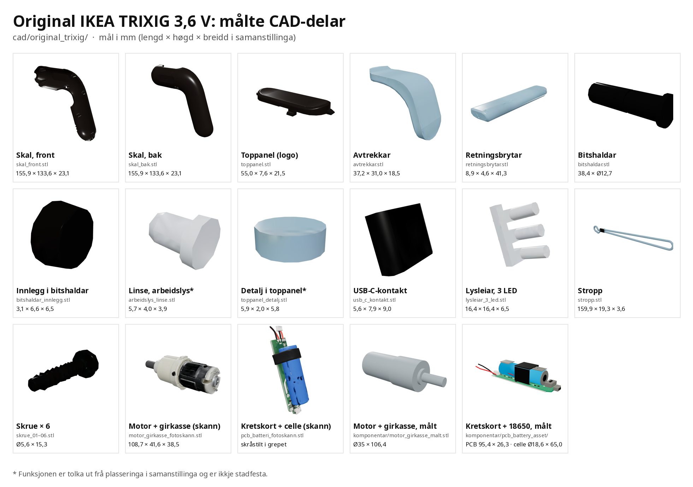
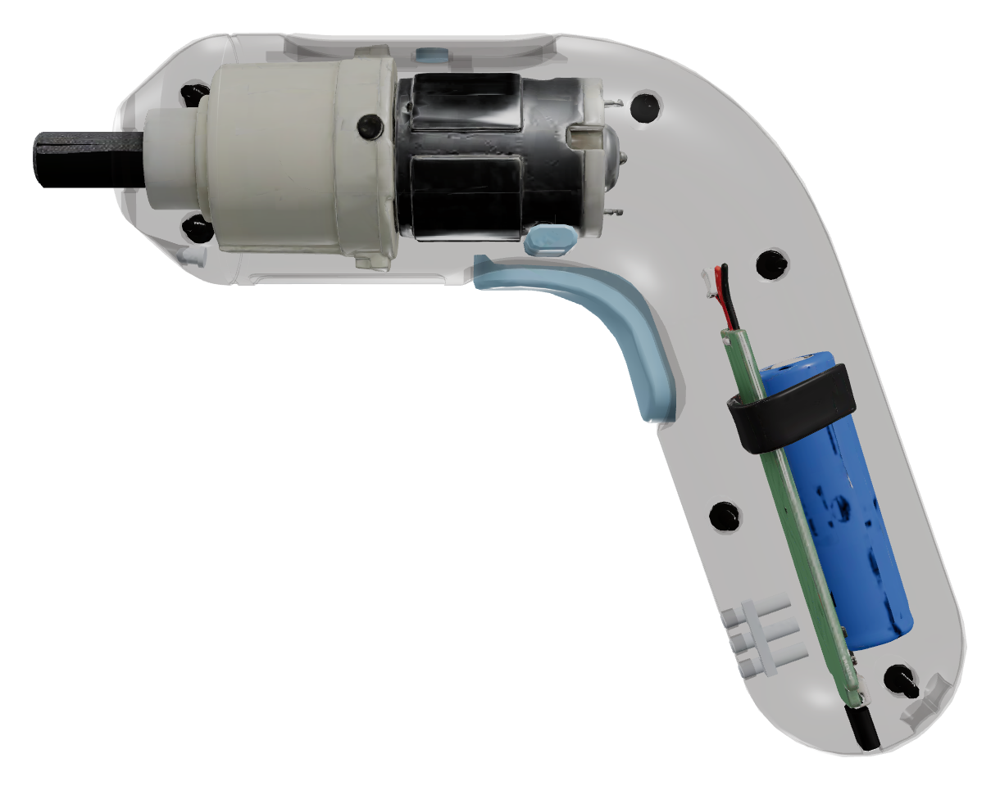

# Original IKEA TRIXIG 3,6 V: målte CAD-delar

Dette er dei CAD-modellerte delane frå den demonterte originalen, samla på éin stad. Dei er grunnlaget for 3D-modelleringa av redesignen.

## Innhald

- `delar/`: 20 delar som STL i millimeter, i samanstillingsposisjon. Importer dei samla, så passar dei i hop.
- `komponentar/`: motor, girkasse, kretskort og celle, modellerte frå skyvelære-mål i eigne koordinatar.
- `malefoto/`: skyvelære-fotoa som måla kjem frå.
- `foto/`: foto av originalen, innmaten og innfestingane.
- `delar_oversikt.png` og `samanstilling_rontgen.png`: oversiktsbileta over.

## Kjelde

- **Skal, panel, brytarar, bitshaldar, stropp og skruer** kjem frå Fusion-dokumentet «IKEA TRIXIG 3.6 original» i prosjektet «IKEA Redesign GK4». Arbeidet er skildra i [`cad/fusion/trixig_cad_rebuild_notes.md`](../fusion/trixig_cad_rebuild_notes.md).
- STL-filene er eksporterte frå `public/assets/00_trixig_parts.glb` i repoet `trixig.iverfinne.no`.
- **Motor og kretskort** finst i to variantar:
  - fotoskann i rett posisjon i samanstillinga (i `delar/`)
  - modellar laga frå skyvelære-mål (i `komponentar/`)

## Koordinatar

- Eininga er millimeter.
- Y peikar opp, X går langs drivaksen og Z er breidda.
- Bitsspissen ligg ved X ≈ −323. Drivaksen ligg 110,5 mm over botnen (Y = 110,5).
- Delingsplanet mellom dei to skalhalvdelane er Z = 0.

## Delar i `delar/`

Måla er storleiken på delen i samanstillinga, som lengd (X) × høgd (Y) × breidd (Z).

| Fil | Del | Mål (mm) | Merknad |
|---|---|---|---|
| `skal_front.stl` | Skalhalvdel, front | 155,9 × 133,6 × 23,1 | Veggtjukkleik 1,6 mm, førehol Ø2,4 for skruene |
| `skal_bak.stl` | Skalhalvdel, bak | 155,9 × 133,6 × 23,1 | Veggtjukkleik 1,6 mm, seks skrueboss Ø8,6 × 10 |
| `toppanel.stl` | Toppanel med logo | 55,0 × 7,6 × 21,5 | |
| `toppanel_detalj.stl` | Rund lyseblå del i hòlet i toppanelet | 5,9 × 2,0 × 5,8 | Funksjonen er ikkje stadfesta |
| `avtrekkar.stl` | Avtrekkar | 37,2 × 31,0 × 18,5 | Heiter «Button» i GLB-fila |
| `retningsbrytar.stl` | Retningsbrytar fram/bak | 8,9 × 4,6 × 41,3 | Går tvers gjennom skalet |
| `bitshaldar.stl` | Bitshaldar | 38,4 × Ø12,7 | Aksel Ø10,1, flens Ø12,7, ¼″ sekskant 6,5 AF × 13 |
| `bitshaldar_innlegg.stl` | Innlegg inne i bitshaldaren | 3,1 × 6,6 × 6,5 | Truleg magneten |
| `arbeidslys_linse.stl` | Liten linse under nasen | 5,7 × 4,0 × 3,9 | Truleg arbeidslyset |
| `usb_c_kontakt.stl` | USB-C-kontakt | 5,6 × 7,9 × 9,0 | I botnen av grepet, opning 9,2 × 3,4 |
| `lysleiar_3_led.stl` | Lysleiar for tre LED-ar på kretskortet | 16,4 × 16,4 × 6,5 | Heiter «Trigger» i GLB-fila |
| `stropp.stl` | Stropp med wirebøyle | 159,9 × 19,3 × 3,6 | Wire Ø3,5 |
| `skrue_01.stl`–`skrue_06.stl` | Skruer, 6 stk | Ø5,6 × 15,3 | Gjenge Ø2,8 × 13, hovud Ø5,6 × 2,2 |
| `motor_girkasse_fotoskann.stl` | Motor og girkasse | 108,7 × 41,6 × 38,5 | Fotoskann i rett posisjon |
| `pcb_batteri_fotoskann.stl` | Kretskort med 18650-celle | 39,2 × 82,2 × 24,3 | Fotoskann, skråstilt i grepet |

## Målte komponentar i `komponentar/`

| Fil | Komponent | Mål (mm) | Laga med |
|---|---|---|---|
| `motor_girkasse_malt.stl` | Motor og girkasse | Motor Ø32 × 47, girkasse Ø35 × 35,4 (inkl. frontboss Ø18 × 3), aksel Ø10 × 24. Totalt 106,4 | [`cad/fusion/trixig_motor_girmodul.py`](../fusion/trixig_motor_girmodul.py) |
| `pcb_battery_asset/` | Kretskort med 18650-celle, i Blender og OBJ, og ei forenkla STL for prøvepassing | Kretskort 95,39 × 26,31 × 1,60, celle Ø18,60 × 65,02 | [`trixig_pcb_battery_blender.py`](../fusion/trixig_pcb_battery_blender.py) og [`trixig_pcb_battery_print_stl.py`](../fusion/trixig_pcb_battery_print_stl.py) |

## Hovudmål for originalen

Kjelde: [`cad/fusion/trixig_cad_rebuild_notes.md`](../fusion/trixig_cad_rebuild_notes.md).

- **Totalt utan stropp:** 171,4 × 133,6 × 46,1 mm (lengd × høgd × breidd), med bitshaldaren.
- **Tønna:** Ø45,6 ved skuldra og Ø44,7 lenger fram. Nasen smalnar inn til Ø16,4.
- **Grepet:** ovalt, 44,4 × 33,0 mm, og skråstilt om lag 17–19° frå loddrett.
- **Skalet:** veggtjukkleik 1,6 mm.

## Skyvelære-måla i `malefoto/`

Fotoa er dei einaste primærkjeldene til måla på motor og kretskort. Fleire avlesingar avvik frå verdiane i skripta og i `komponentar/`. Sjekk mot den fysiske delen før du modellerer tette passingar.

| Foto | Avlesing (mm) | Kva som er målt | Verdi i modellen |
|---|---|---|---|
| `motor_01.png` | 10,64 | Diameter på akselen | Ø10,0 |
| `motor_02.png` | 32,10 | Truleg diameter på girkassa ved motoren* | (ikkje modellert) |
| `motor_03.png` | 22,03 | Truleg lengda på frontparti og aksel* | – |
| `motor_04.png` | 33,36 | Truleg lengda frå girkasseskuldra til akselspissen* | – |
| `motor_05.png` | 18,17 | Diameter på frontbossen | Ø18,0 |
| `motor_06.png` | 35,40 | Største diameter på girkassa | Ø35,0 |
| `motor_07.png` | 106,08 | Total lengd, motor og girkasse | 106,4 |
| `motor_08.png` | 32,41 | Truleg diameter på girkassekroppen* | (ikkje modellert) |
| `motor_09.png` | 30,83 | Diameter på motorhuset | Ø32,0 |
| `motor_10.png` | 37,14 | Truleg lengda på motorhuset* | – |
| `motor_11.png` | 15,03 | Diameter på halsen mellom frontboss og aksel | (ikkje modellert) |
| `motor_12.png` | 47,01 | Lengd frå motorbakkant til girkassa | 47,0 |
| `pcb_og_batteri_01.png` | 65,82 | Lengda på 18650-cella | 65,02 |
| `pcb_og_batteri_02.png` | 20,02 | Tjukkleik på kretskort og celle saman | ≈20,2 |
| `pcb_og_batteri_03.png` | 95,39 | Lengda på kretskortet | 95,39 |
| `pcb_og_batteri_04.png` | 25,31 | Breidda på kretskortet | 26,31 (truleg tastefeil) |

\* Kva som er målt, er tolka ut frå fotoet og ikkje stadfesta.

## Foto i `foto/`

| Fil | Viser |
|---|---|
| `original_produktfoto.jpg` | IKEA sitt produktfoto av originalen |
| `innmat_ovanfra.jpg` | Motor, girkasse og kretskort med celle på plass i det opne skalet |
| `innmat_perspektiv.jpeg` | Same innmat sett skrått |
| `demonterte_skalhalvdelar.jpeg` | Begge skalhalvdelane, med vogga for motoren, avtrekkar med fjør, skruer og stropp |
| `batteriinnfesting.jpeg` | Korleis kretskortet og cella er festa i grepet, med lysleiaren og avtrekkaren |
| `kretskort_komponentside.jpg` | Komponentsida av kretskortet, med brytar og leidningar |
| `motor_referanseteikning.png` | Referanseteikninga motorskriptet byggjer på. Ho er laga med KI, og måla hennar er runda av. Bruk skyvelære-måla over |
